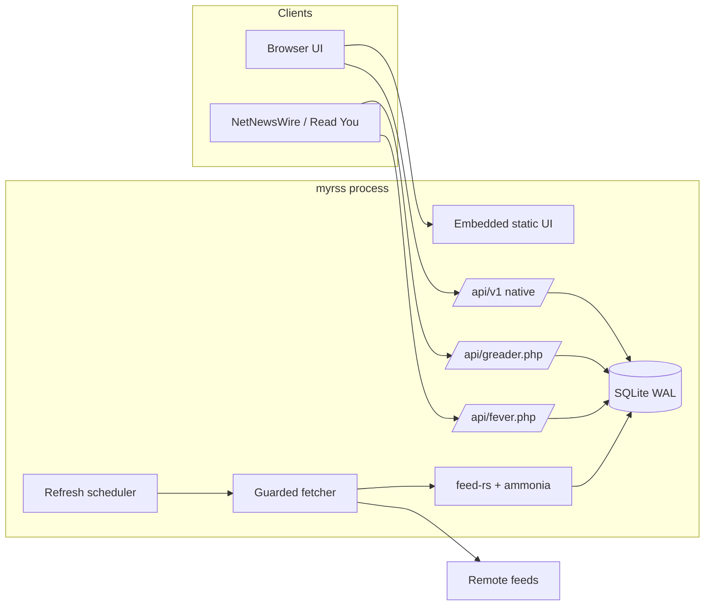
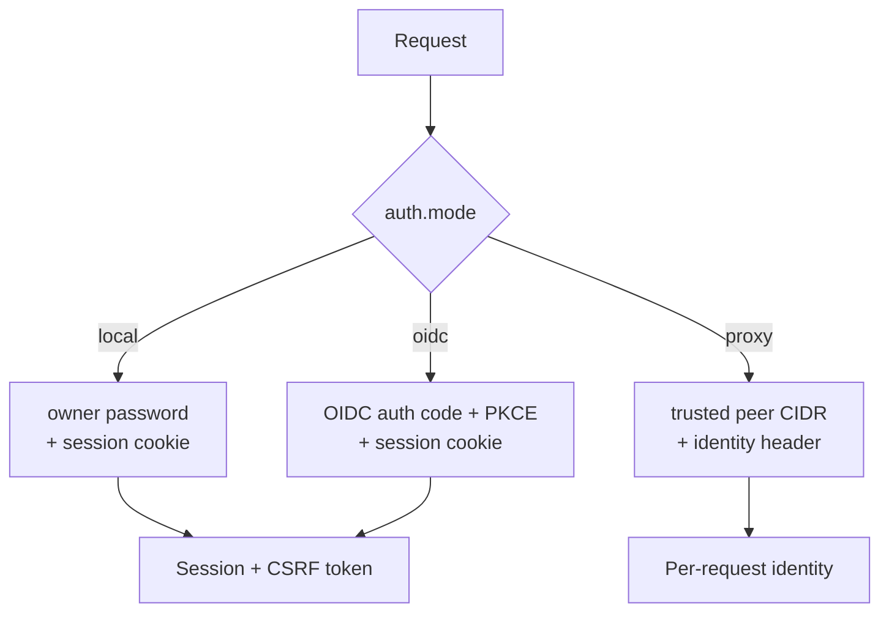

# Architecture

myrss is one Rust process: an Axum HTTP server, embedded static UI, scheduler,
guarded feed fetcher, parser/sanitizer, and SQLite database. There are no
queues, workers, Node services, or secondary databases.

- Browser, native JSON, Google Reader, and Fever APIs share the same feed and
  entry tables and the same auth module.
- Feed I/O happens outside database transactions; SQLite uses WAL, bounded
  connections, and transactional entry/state writes.
- Fetching is bounded (size, time, redirects) and rejects private-network
  targets unless explicitly allowed — see [security](SECURITY.md).

## Auth modes

Exactly one of three modes is active, selected by `auth.mode`:

App credentials for reader clients are independent of all three modes and
authenticate only the compat APIs (`/api/greader.php`, `/api/fever.php`) and the
native credential-scoped calls.
