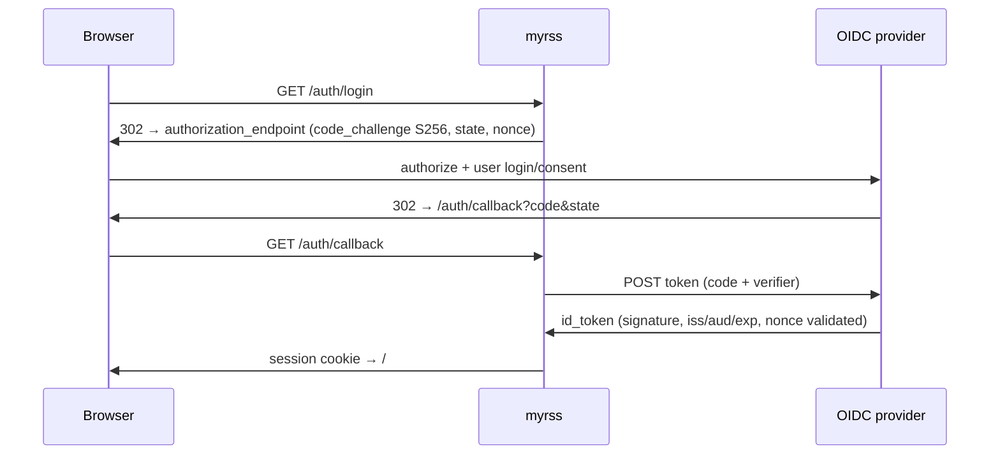
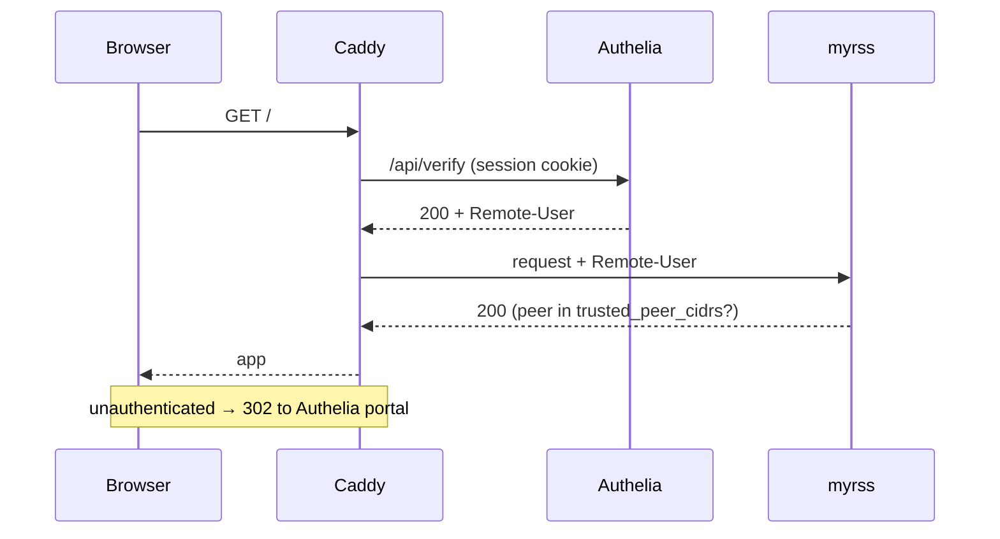

# Deployment

## Docker Compose

```sh
cp config.example.toml config.toml
mkdir -p secrets
printf 'choose-a-long-owner-password' > secrets/owner-password.txt
chmod 600 secrets/owner-password.txt
docker compose up -d --build
```

Edit only `config.toml`. Keep the default local-auth password in
`secrets/owner-password.txt`, mounted as
`/run/myrss-secrets/myrss_owner_password`.

## Reverse proxy

Terminate TLS at the proxy and forward to `http://myrss:8080`. Keep
`public_url` as the canonical browser URL. Native API paths
(`/api/greader.php`, `/api/fever.php`) must bypass interactive SSO redirects —
reader apps authenticate with their own per-app credentials.

Minimal Caddy example:

```caddyfile
rss.example.com {
	handle /api/greader.php* { reverse_proxy myrss:8080 }
	handle /api/fever.php*   { reverse_proxy myrss:8080 }
	handle                   { reverse_proxy myrss:8080 }
}
```

## SSO: OIDC or forward auth

### OIDC (authorization code + PKCE)

```toml
[auth]
mode = 'oidc'

[auth.oidc]
issuer_url = 'https://auth.example.com'
client_id = 'myrss'
client_secret_file = '/run/myrss-secrets/oidc_client_secret'  # optional
subject = 'authelia-subject-claim'                            # optional pin
```

The login flow, validated end-to-end:



### Forward auth (trusted proxy header)

Verified layout with Caddy `forward_auth` + Authelia — see the complete,
tested example in [examples/caddy-authelia](../examples/caddy-authelia):



myrss only honors the identity header when the **direct TCP peer** matches
`trusted_peer_cidrs` — a spoofed header from any other host is rejected:

```toml
[auth]
mode = 'proxy'

[auth.proxy]
trusted_peer_cidrs = ['172.30.0.10/32']  # Caddy container
user_header = 'Remote-User'
expected_user = 'alice'
```

Pin the proxy container to a static IP so the CIDR check holds. Route the
compat API paths past `forward_auth` as shown in the example `Caddyfile`.

## Backup and restore

```sh
docker compose exec --user myrss myrss myrss --config /etc/myrss/config.toml backup /var/lib/myrss/backup.db
```

Restore by stopping the service, replacing `myrss.db` and its `-wal`/`-shm`
files with the backup, then starting it. Do not copy only a live `.db` file.

## Migrate from FreshRSS SQLite

Stop FreshRSS, then run the importer against its user database
(`data/users/<name>/db.sqlite`):

```sh
docker compose stop myrss
docker compose run --rm \
  -v /path/to/db.sqlite:/freshrss-data:ro \
  myrss --config /etc/myrss/config.toml import-freshrss /freshrss-data
docker compose up -d myrss
```

It accepts a FreshRSS `data` directory, a `data/users/<name>` directory, or a
`db.sqlite` path. It imports categories as folders, feeds and their HTTP
credentials, articles, read/starred state, and labels. FreshRSS
MySQL/PostgreSQL databases should be migrated/exported to SQLite or OPML
first; OPML imports subscriptions only.
