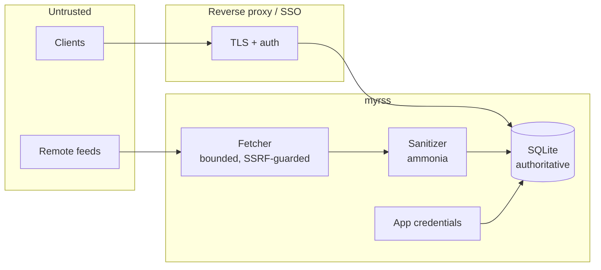

# Security

## Trust boundaries

- Remote feeds and clients are hostile; the database is authoritative.
- Browser sessions, OIDC, proxy identity, and per-app credentials are
  independent trust domains — compromising an app credential cannot manage
  owner credentials or backups.

## Deployment

- Store the SQLite database on local disk, not a network filesystem.
- Use HTTPS at a reverse proxy. Keep `public_url` exact.
- Secrets belong in Docker Secrets or permission-restricted files. Do not
  commit `secrets/` or `config.toml` containing secrets. Imported per-feed
  HTTP credentials are stored in SQLite; protect the data volume with
  filesystem permissions and backups.

## Fetching and content

- Feed fetches are limited to HTTP(S), bounded size/time/redirects, and
  reject private-network destinations unless `feed.allow_private_networks` or
  `feed.allowed_hosts` explicitly permits them.
- Article HTML is sanitized with ammonia. Scripts, forms, styles, unsafe URL
  schemes, and remote media are removed or blocked. Remote media is off by
  default.

## Authentication

- Browser sessions use opaque HttpOnly/SameSite cookies, CSRF headers,
  expiry, and login throttling.
- OIDC uses Authorization Code + PKCE, state, nonce, issuer/audience/expiry
  validation, and JWKS signature validation. Optionally pin
  `auth.oidc.subject`.
- Trusted-proxy auth fails closed unless the direct peer matches configured
  CIDRs **and** the configured identity header is present.
- Reader apps use named, revocable credentials. Fever's MD5 API key is a wire
  credential, not password storage.

## Hardening

- Responses use CSP, `nosniff`, no-referrer policy, request-size limits, and
  parameterized SQL.
