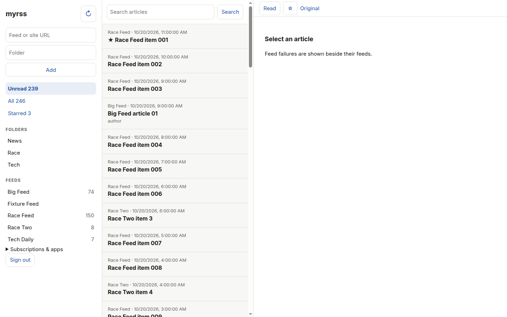
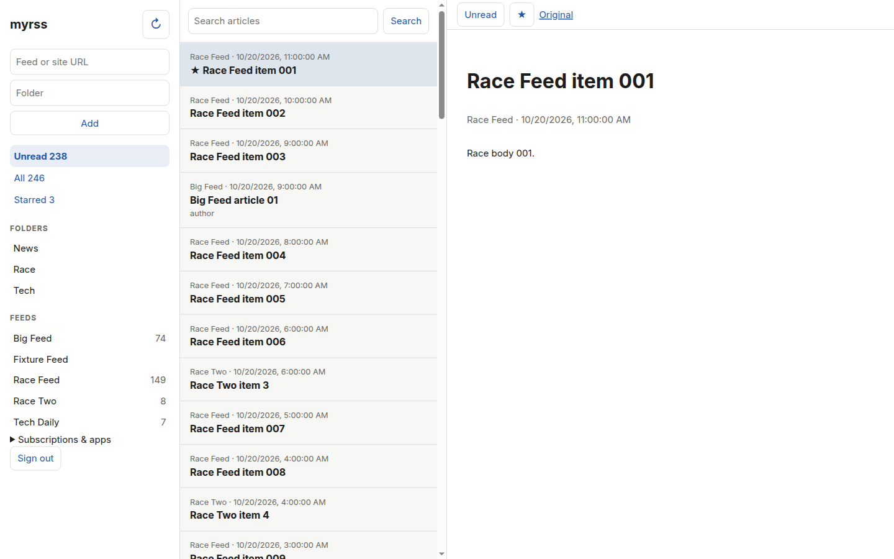
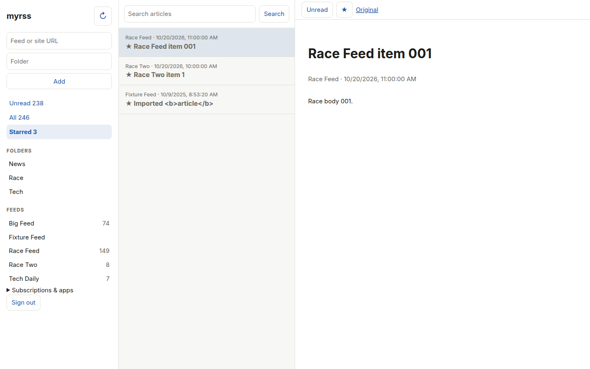

# User guide

Sign in as the owner. Add a feed URL or a site URL; autodiscovery finds RSS,
Atom, or JSON feeds. Organize feeds into folders, import/export OPML, read the
unread/all/starred views, and search article text.

Selecting an article marks it read.

Use the sidebar to choose a collection, folder, or feed. Within a folder or
feed, the reading-status control switches between unread, all, starred, and
read articles without losing that scope. Search and label filters combine
with that selection; **Clear filters** resets the scope, search, and label
while keeping the reading status. Labels appear when your library has them.

Switch between comfortable and compact lists using the icons beside the
reading-status control. On desktop, expand the reader for distraction-free
reading. On smaller screens, the menu button opens your library and the
article's back arrow returns to the list.

Keyboard: `j`/`k` move between articles, `s` stars, `m` toggles read,
and `Esc` returns to the list.

## Settings

**Settings** is a separate screen, linked at the bottom of the sidebar.
Choose a light, dark, or system theme, list density, and reading text size
under **Appearance**. These preferences are saved in the current browser.

Under **Subscriptions**, add, pause/resume, or remove feeds, see feed errors,
and import/export OPML. Removing a feed also deletes its articles and requires
confirmation. Adding a feed is also available directly from the sidebar.

## Reader apps

Create a named app credential in **Settings → Reader apps**:

- FreshRSS/Google Reader URL: `https://your-host/api/greader.php`
- Fever URL: `https://your-host/api/fever.php`
- Fever API key: `MD5(username:password)` — most clients compute it for you;
  Read You wants URL + username + password as entered in the credential.

Copy the password immediately; it is not shown again. Revoke a credential to
disconnect only that app. Verified with NetNewsWire (Google Reader API) and
Read You (Fever API).
